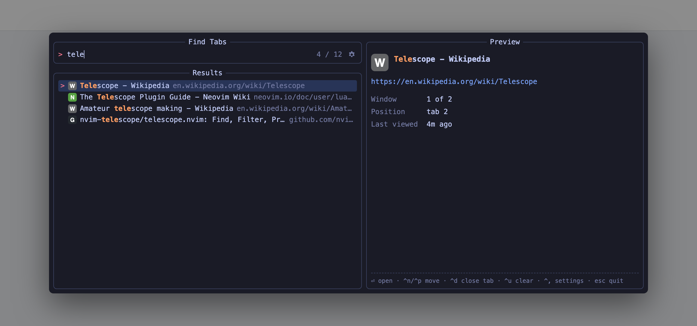

# Tabscope

Fuzzy-find your open tabs by title or URL, in a telescope.nvim-style picker. Also lets you jump back to your previous tab and walk back and forward through recently used tabs. Works in Brave, Chrome and other Chromium browsers, and in Firefox 140+.

## Install

1. Open `brave://extensions` (or `chrome://extensions`) and turn on **Developer mode**.
2. Click **Load unpacked** and pick this folder.
3. The default hotkeys below are set on install. Change them at `brave://extensions/shortcuts`.

### Firefox

1. Run `./build.sh firefox` (needs Python 3). It writes `tabscope.xpi`.
2. Open `about:debugging#/runtime/this-firefox`, click **Load Temporary Add-on** and pick `tabscope.xpi`.
3. Firefox keeps the add-on until it restarts. Change hotkeys at `about:addons` → gear menu → **Manage Extension Shortcuts**.

Add `--dev` (`./build.sh firefox --dev`) to build `tabscope-dev.xpi`. It is named "Tabscope (dev)", and its finder has a green outline, so you can tell it apart from an installed release.

`./build.sh chrome --dev` also writes `dist/chrome-dev/`. Load that folder with **Load unpacked**. After a change, rebuild and click **Reload** on the extensions page.

The build takes `manifest.json`, applies the overrides in `firefox-manifest.json` (an event-page background and the Gecko add-on ID) and drops the `favicon` permission. Firefox has no favicon endpoint, so the picker shows the icon each tab reports. A permanent install needs a build signed through addons.mozilla.org.

## Hotkeys

| Default (macOS) | Default (Windows/Linux) | Action |
| --- | --- | --- |
| `⌃⇧F` | `Alt+Shift+F` | Open the tab finder |
| `⌃⇧P` | `Alt+Shift+P` | Swap to the previous tab (press again to swap back) |
| `⌃H` | `Alt+Shift+H` | Walk back through recently used tabs |
| `⌃L` | `Alt+Shift+L` | Walk forward again |

The defaults avoid every shortcut in Brave's menus, because the browser silently skips a default that clashes with one of its own shortcuts. You can still set a clashing key such as `⌘⇧F` by hand on the shortcuts page, and it then overrides the browser's.

The swap works like vim's alternate file (`Ctrl-^`), and the walk like its jumplist, on vim's left/right keys. Walking back steps through your tabs in most-recently-used order without reshuffling that order, so repeated presses keep going further back. Opening a tab any other way ends the walk, and the tab you stopped on counts as visited.

## Finder keys

| Key | Action |
| --- | --- |
| type | fuzzy filter (space-separated terms must all match) |
| `↓` `^n` `^j` / `↑` `^p` `^k` | move selection |
| `PgDn` / `PgUp` | move by 10 |
| `⏎` / click | switch to the tab (and focus its window) |
| `^d` / `⌥d` | close the selected tab |
| `^u` | clear the query |
| `^,` | open settings |
| `esc` / `^c` / hotkey again | quit |

With an empty query, tabs are listed most recently used first and the current tab goes last, so the hotkey followed by `⏎` takes you back to your previous tab.

## Settings

Click the gear in the finder's search box, press `^,`, or right-click the toolbar icon and choose **Options**.

- **Strictness** (0–100): each search term gets a quality score, where 100 means its letters are consecutive and start at a word. Terms scoring below the strictness are dropped. 0 keeps any match with the letters in order. Around 60 drops most scattered matches.
- **Case**: smart (ignore case unless you type a capital), always ignore, or always match.
- **Match URLs**: search URLs as well as titles.
- **Order while searching**: best match, or most recently used.

The settings page has a live preview against your open tabs, showing each match's quality and crossing out the ones your strictness drops.

## How it works

- The finder hotkey injects `overlay.js` into the current page. It adds a full-screen iframe of `palette.html`, so page CSS and scripts can't interfere with the picker.
- On pages that extensions can't script (`brave://`, the new tab page, the Web Store, PDFs), the picker opens as the toolbar popup instead.
- `background.js` keeps the most-recently-used tab list across all windows. It drives the finder's ordering, the swap and the walk.
- `fuzzy.js` is an fzf-style scorer. It gives bonuses for matches at word boundaries, at camelCase humps and in consecutive runs, and penalties for gaps.

## Releasing

`version` in `manifest.json` is the release version. Tags are `v` plus that version. Releases are cut from a clean `main` and need `gh` logged in.

1. `./release.sh prepare` bumps the patch version (`prepare minor` or `prepare major` for the others), commits, tags it and builds `dist/tabscope-<version>.zip` and `dist/tabscope-<version>-unsigned.xpi`. Nothing is pushed.
2. Upload the unsigned xpi to addons.mozilla.org and download the signed copy.
3. `./release.sh publish <signed.xpi>` releases the version tagged at `HEAD`. It checks that the xpi is signed and has the right version, pushes `main` and the tag, and creates the GitHub release with the zip and the signed xpi.

## Credits

Inspired by [telescope.nvim](https://github.com/nvim-telescope/telescope.nvim) for the picker and [fzf](https://github.com/junegunn/fzf) for the matching.

## License

[MIT](LICENSE)
